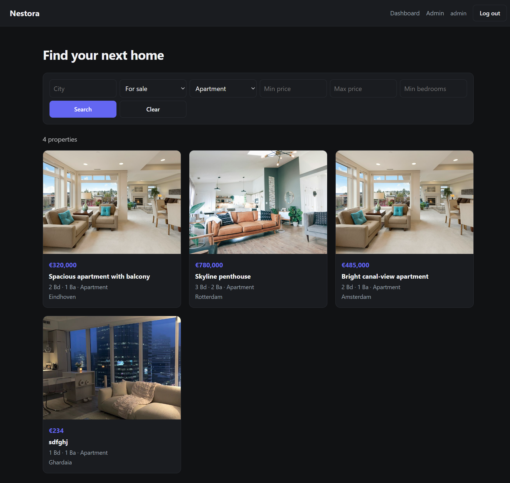
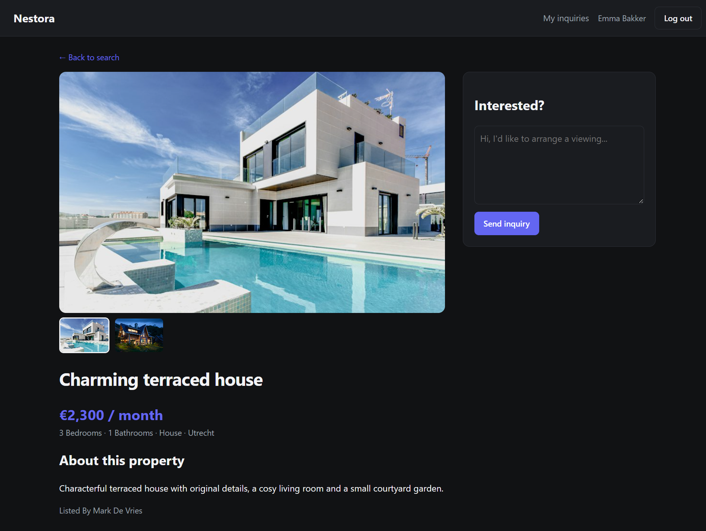
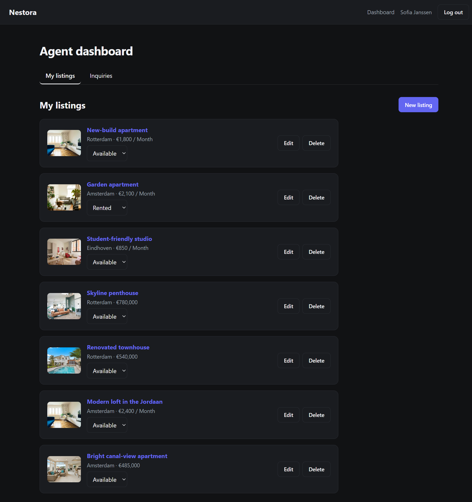
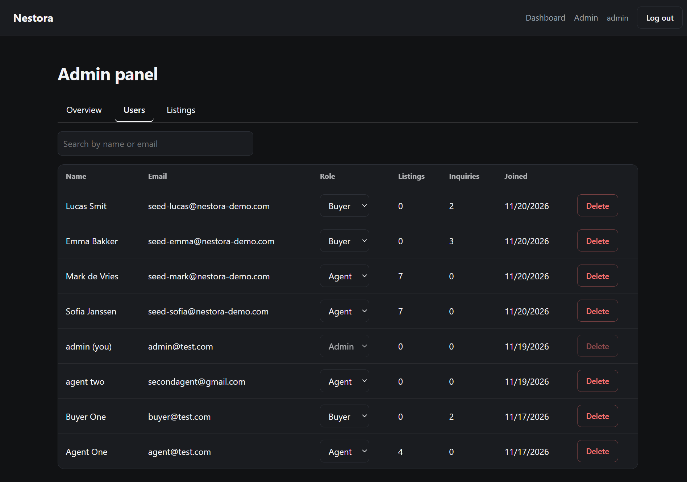
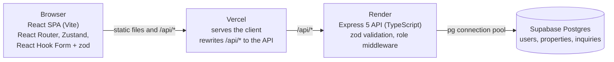

# Nestora

A full-stack real estate platform. Buyers search and filter properties and contact agents, agents manage their own listings and answer inquiries, and admins manage users and moderate every listing.

**Live demo:** https://nestora-seven-pi.vercel.app/
**Case study:** [docs/case-study.md](docs/case-study.md)






## Features

- Property search with filters (city, buy or rent, property type, price range, bedrooms) and pagination, with the filters kept in the URL so a search can be shared
- Property details page with a photo gallery and an inquiry form
- Authentication with a JWT stored in an httpOnly cookie, plus protected routes
- Three roles with different permissions (see below)
- Full CRUD on two related resources: properties and inquiries
- Client and server validation on every form, using zod on both sides
- Loading skeletons, empty states, error states with a retry button, toast notifications and a responsive layout with light and dark themes
- Admin overview with platform stats, user management and listing moderation

## Roles

| Role  | Can do                                                                                                              |
| ----- | ------------------------------------------------------------------------------------------------------------------- |
| Buyer | Browse and search, send inquiries, edit an inquiry until an agent answers it, delete their own inquiries            |
| Agent | Create, edit, delete and change the status of their own listings, reply to or close inquiries on their own listings |
| Admin | Everything an agent can do on any listing, plus list users, change roles and delete users                           |

Permissions are enforced on the server through `requireAuth` and `requireRole` middleware and explicit ownership checks, not only hidden in the interface. The current role is read from the database on every request, so a role change takes effect immediately instead of when a token expires.

## Architecture



**Data model.** A user has a role (`buyer`, `agent` or `admin`). An agent owns many properties. A buyer sends many inquiries, and each inquiry belongs to one property. Deleting a user or a property cascades to the rows that depend on it.

**Same-origin API.** The client and the API are on different hosts, so a login cookie would normally be a third-party cookie, which many browsers block. Vercel rewrites every `/api/*` request to the Render service, so the browser only talks to one origin and the session cookie stays first-party.

**Stack**

- Frontend: React, Vite, TypeScript, React Router, Zustand, React Hook Form, zod, react-hot-toast
- Backend: Node.js, Express 5, TypeScript, pg, bcrypt, jsonwebtoken, zod
- Database: PostgreSQL on Supabase
- Testing: Vitest, Supertest, Testing Library
- Hosting: Vercel (client), Render (API), Supabase (database)

## Demo accounts

The live database contains sample data. You can log in with these accounts (password for all of them: `password123`):

| Account                     | Role                                                     |
| --------------------------- | -------------------------------------------------------- |
| seed-sofia@nestora-demo.com | Agent, owns several listings and has inquiries to answer |
| seed-emma@nestora-demo.com  | Buyer, has sent inquiries and received replies           |

The admin panel is not publicly available. To see it, run the project locally and promote your own account (step 6 below).

## Run locally

Requirements: Node.js 20 or newer and a Postgres database. The project uses a free Supabase project.

1. **Clone and install**
   ```bash
   git clone https://github.com/ellie-dhm/Nestora.git
   cd Nestora
   cd server && npm install
   cd ../client && npm install
   ```
2. **Create the tables.** In the Supabase SQL Editor, run `server/sql/001_init.sql` and then `server/sql/002_inquiry_reply.sql`.
3. **Configure the server.** Create `server/.env`:
   ```
   DATABASE_URL=postgresql://postgres.<project-ref>:<password>@<host>.pooler.supabase.com:6543/postgres
   JWT_SECRET=a-long-random-string
   PORT=4000
   CLIENT_URL=http://localhost:5173
   ```
   Use the transaction pooler connection string from the Supabase Connect dialog.
4. **Configure the client.** Create `client/.env`:
   ```
   VITE_API_URL=http://localhost:4000
   ```
5. **Optional: load sample data.**
   ```bash
   cd server && npm run seed
   ```
   This creates two agents, two buyers, fourteen listings in five cities and a few inquiries. It is safe to run again, because it removes its own previous data first.
6. **Start both apps** in two terminals:
   ```bash
   cd server && npm run dev
   cd client && npm run dev
   ```
   Open http://localhost:5173. To create an admin, sign up normally and then run this in the SQL Editor:
   ```sql
   update users set role = 'admin' where email = 'you@example.com';
   ```

## Deployment

- **Frontend:** Vercel, root directory `client`. `client/vercel.json` rewrites `/api/*` to the backend and falls back to `index.html` so React Router URLs work on refresh.
- **Backend:** Render web service, root directory `server`. Build command `npm install --include=dev && npm run build`, start command `npm start`. Environment variables: `DATABASE_URL`, `JWT_SECRET`, `NODE_ENV=production` and `CLIENT_URL`.
- **Database:** Supabase Postgres, reached through the transaction pooler.

## Tests

```bash
cd server && npm test   # API tests (Vitest and Supertest), run against the configured database
cd client && npm test   # component tests (Vitest and Testing Library)
```

There are 24 tests in total: 16 on the server and 8 on the client.

- **Server:** registration and login validation, duplicate emails, wrong passwords, session handling, role denial, ownership checks on listings and inquiries, the public city filter and admin access control. The tests create users with `test...@example.com` addresses and delete them afterwards.
- **Client:** route protection by role, loading state of protected routes, login form validation and price formatting.

## Project structure

```
server/
  src/routes/        auth, properties, inquiries, admin
  src/middleware/    requireAuth, requireRole
  sql/               database schema
  scripts/seed.ts    sample data
  tests/             API tests
client/
  src/pages/         Home, PropertyDetails, MyInquiries, AgentDashboard, AdminPanel, Login, Register
  src/components/    Navbar, PropertyCard, PropertyForm, ProtectedRoute, EmptyState, skeletons
  src/store/         Zustand auth store
  src/lib/           API client, types, formatting
docs/                screenshots and case study
```

## Possible improvements

- Image uploads with Supabase Storage (listings currently use image URLs)
- Charts on the admin overview
- Email notifications when an inquiry is received or answered
- Saved properties for buyers
